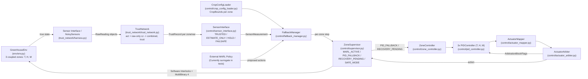

# Architecture Documentation

This document describes the implemented runtime architecture of the three-zone GreenHouse MARL system as verified in Phase 6.

---

## 1. End-to-End Pipeline



---

## 2. Component Responsibilities

| Component | File | Responsibility |
|---|---|---|
| `GreenhouseEnv` | [env/env.py](../env/env.py) | PettingZoo `ParallelEnv` simulating 3 coupled zones (`zone_1`, `zone_2`, `zone_3`), Euler stability checks, `MultiBinary(4)` actions `[heat, fan, mist, water]`, raw 9-float observations. |
| `TrustNetwork` | [trust_network/trust_network.py](../trust_network/trust_network.py) | Maintains independent `AssumedParams`; computes actuator-history (`T`, `H`, `M`) and raw-only neighbor cross-zone (`T`, `H`) predictions; isolates `NaN`/`Inf`/missing readings; updates EMA `trust` via `HealthyResiduals`. |
| `SensorInterface` | [control/sensor_interface.py](../control/sensor_interface.py) | Decouples control from `TrustNetwork` internals; validates finiteness and optional timestamp staleness; classifies readings into `TRUSTED`, `ESTIMATE_ONLY`, `HOLD_TRANSIENT`, or `UNRELIABLE_FAILSAFE`. |
| `CropConfigLoader` | [control/crop_config_loader.py](../control/crop_config_loader.py) | Loads and unit-validates crop profiles (`degC`, `RH_percent`, `relative_percent`, `degF -> degC`); supplies per-zone `CropBounds` independently of PID gains. |
| `PIDController` | [control/pid_controller.py](../control/pid_controller.py) | Discrete PID/PI loop per variable with optimal-band deadband, filtered derivative-on-measurement, back-calculation + external-block anti-windup, variable `dt`, unidirectional `M` unwinding, `enable()`/`disable()`, and `track_shadow()`. |
| `ActuatorMapper` | [control/actuator_mapper.py](../control/actuator_mapper.py) | Converts continuous `[-1, 1]` PID outputs to time-proportioned (PWM) heater/mister commands, pulse/soak-limited water pump commands, and continuous fan demands; enforces `DwellTracker` min on/off durations and MARL->PID irrigation pulse sync. |
| `ActuatorArbiter` | [control/actuator_arbiter.py](../control/actuator_arbiter.py) | Resolves shared-fan conflicts between `T` and `H` using `AmbientState`, severity excursion, hysteresis, and mutual exclusion (`heat + cooling fan`, `mist + drying fan`); returns `ArbitrationBlockFlags`. |
| `ZoneController` | [control/zone_controller.py](../control/zone_controller.py) | Composes 3 independent `PIDController` instances (`T`, `H`, `M`), `ActuatorMapper`, and `ActuatorArbiter` for one zone with defensive config isolation. |
| `ZoneSupervisor` | [control/supervisor.py](../control/supervisor.py) | Enforces `VALID_TRANSITIONS` FSM per zone, validates MARL actions (`validate_marl_action`), checks divergence/safety, handles PID exception isolation to `SAFE_MODE`, applies software interlocks, and updates `ZoneMetrics`. |
| `FallbackManager` | [control/fallback_manager.py](../control/fallback_manager.py) | Coordinates the 3 independent `ZoneSupervisor` instances around `GreenhouseEnv`, isolates per-zone exceptions to `SAFE_MODE`, and emits `MultiBinary(4)` actions and telemetry. |
| `EpisodeEvaluator` | [control/metrics.py](../control/metrics.py) | Computes RMSE, MAE, IAE, overshoot, settling time, switching frequency, fallback/recovery timing, and safe-mode counts. |

---

## 3. Data Contracts & Coupling

### Three-Zone Physical & Information Coupling
- **Physical coupling** ([env/env.py](../env/env.py)): Every zone exchanges heat (`k_T = 0.6`) and humidity (`k_H = 0.03`) with both neighboring zones (`all-pairs` 3-zone layout). Soil moisture (`M`) has **no inter-zone coupling**.
- **Control isolation**: Each zone owns an isolated `ZoneController` and `ZoneSupervisor` (copied `PIDGains` and `ActuatorConfig`). One zone's agent crash, PID exception, or sensor fault never corrupts another zone's PID state, dwell timers, irrigation budget, or mode.

### Observation & Action Structure
- **`GreenhouseEnv` Observation (`shape=(9,)`, `float32`)**: `[T_self, H_self, M_self, T_nb1, H_nb1, M_nb1, T_nb2, H_nb2, M_nb2]`.
- **`GreenhouseEnv` Action (`MultiBinary(4)`, `int8`)**: `[heat, fan, mist, water]`, where `0 = OFF`, `1 = ON`.

---

## 4. Module Dependencies & Discrepancies Found vs. Earlier Specs

```text
control/types.py (zero internal deps)
  ├── control/pid_controller.py
  ├── control/crop_config_loader.py ──▶ pid_controller.validate_pid_gains
  ├── control/actuator_mapper.py
  ├── control/actuator_arbiter.py ──▶ actuator_mapper
  ├── control/zone_controller.py ──▶ pid_controller, actuator_mapper, actuator_arbiter
  ├── control/sensor_interface.py
  ├── control/supervisor.py ──▶ zone_controller
  └── control/fallback_manager.py ──▶ crop_config_loader, sensor_interface, supervisor, zone_controller

env/env.py (pettingzoo, gymnasium, numpy)
trust_network/trust_network.py (numpy only; duck-typed from env/control)
```

### Discrepancies vs. Earlier Design Documents
1. [control/pdireadme.md](../control/pdireadme.md) still states `"Implementation status: Proposed"` and shows root-level `config/` and `tests/` paths; actual implementation resides in `control/`, `control/configs/`, `control/tests/`, and `trust_network/`.
2. `TrustNetwork` resides in [trust_network/trust_network.py](../trust_network/trust_network.py) rather than `control/trust_network.py`, and neither `env/` nor `trust_network/` defines `__init__.py`.
3. `TrustConfig.conf_act` remains a static `0.5` placeholder rather than historical residual-variance calibration; `L` and CO₂ are deferred from both `env/env.py` and `trust_network.py`.
4. No trained MAPPO controller exists yet (`_simple_healthy_marl` surrogate is used in tests).
