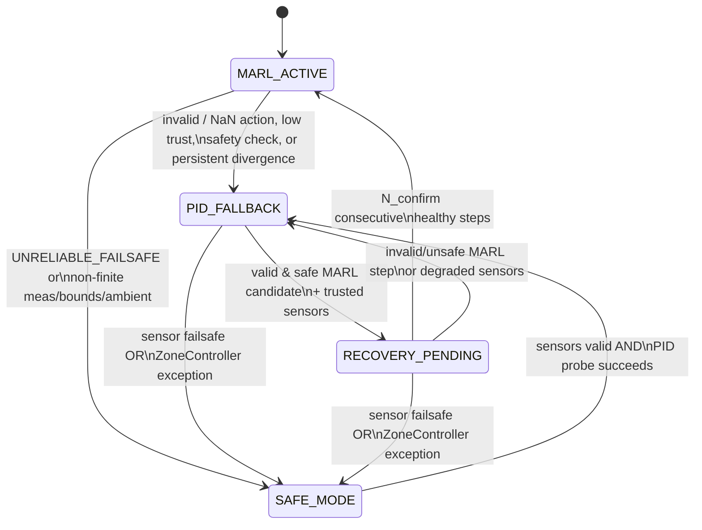

# Fault Tolerance, Trust Isolation, and Supervisory FSM

---

## 1. Trust Network Fault Handling ([trust_network/trust_network.py](../trust_network/trust_network.py))

### Raw-In / Trust-Gates-Out Invariant
- `estimate_cz()` accepts `RawReading` instances only and rejects `CorrectedValue` with `TypeError` and non-finite `RawReading` values with `ValueError`.
- Estimator anchors (`self.est`) always track `combined`—never `belief`—preventing faulty sensor values from feeding back into physics predictions.

### Behavior on Invalid (`NaN`, `Inf`, `None`, Missing) Readings
1. **Valid prior anchor (`reset()` succeeded)**:
   - Invalid `raw` is **not** replaced with a fabricated plausible value; `TrustRecord.raw` preserves `nan`/`inf` and `raw_weight` becomes `0.0`.
   - `est_act` propagates finitely from `self.est[z][v]`.
   - `est_cz` couples only to neighbors whose previous raw reading was valid (`_raw_valid[n][v]`); if no valid neighbors exist, `est_cz = None` and `combined = est_act`.
   - `conf_cz` is `0.0` (if `est_cz` exists) for the invalid zone, while healthy neighbors compute `confidence_cz` over their valid neighbors only.
   - `match = 0.0`, EMA `trust` decays toward `trust_floor` (`0.02`), and `belief = combined` (finite).
2. **Invalid cold-start (`reset()` saw invalid reading)**:
   - `TrustNetwork` refuses to invent a value (`est_valid = False`, `combined = nan`, `belief = nan`, `trust = trust_floor`), cold-anchoring when the first valid reading arrives.
3. **Recovery**:
   - When valid readings resume, `trust` climbs gradually via EMA `(1 - alpha_trust) * trust + alpha_trust * match` (`alpha_trust = 0.1`), rather than jumping instantaneously to `1.0`.

---

## 2. Sensor Quality Escalation ([control/sensor_interface.py](../control/sensor_interface.py))

`SensorInterface` classifies each `(zone, var)` independently:
1. `TRUSTED`: finite, non-stale `raw` with `trust >= theta_trust_good` (`0.60`); outputs `belief` (or `raw`).
2. `ESTIMATE_ONLY`: invalid/stale `raw` or `trust < theta_trust_good`, while `combined` is finite, `confidence >= theta_est_min` (`0.15`), and `open_loop_steps < t_est_max[var]` (`T: 120`, `H: 120`, `M: 15`).
3. `HOLD_TRANSIENT`: both unavailable or open-loop cap exceeded for up to `t_hold_max` (`5`) steps; PID freezes integral, zeros derivative, and holds `last_output`.
4. `UNRELIABLE_FAILSAFE`: hold limit exceeded; forces `ZoneSupervisor` into `SAFE_MODE`.

---

## 3. ZoneSupervisor State Machine ([control/supervisor.py](../control/supervisor.py))

### Explicit Transition Graph (`VALID_TRANSITIONS`)
| Current State | Allowed Targets |
|---|---|
| `MARL_ACTIVE` | `PID_FALLBACK`, `SAFE_MODE` |
| `PID_FALLBACK` | `RECOVERY_PENDING`, `SAFE_MODE` |
| `RECOVERY_PENDING` | `MARL_ACTIVE`, `PID_FALLBACK`, `SAFE_MODE` |
| `SAFE_MODE` | `PID_FALLBACK` |

- Same-state requests (`new_mode == self.mode`) are idempotent no-ops.
- Illegal bypasses (e.g., `SAFE_MODE -> MARL_ACTIVE`, `SAFE_MODE -> RECOVERY_PENDING`, `PID_FALLBACK -> MARL_ACTIVE`, `MARL_ACTIVE -> RECOVERY_PENDING`) increment `invalid_transitions_rejected`, log a warning, record `last_fault_reason`, and raise `ValueError`.

---

## 4. `SAFE_MODE`, PID Failure Isolation (`FB-09`), and Recovery

- **Per-zone isolation**: Both `ZoneSupervisor._try_run_pid()` and `FallbackManager.step()` catch operational exceptions (`ValueError`, `TypeError`, `KeyError`, `ArithmeticError`, `RuntimeError`) at the single-zone boundary, log the traceback, increment `pid_failures`, and isolate **only that zone** into `SAFE_MODE` outputting `(0, 0, 0, 0)`. Healthy zones continue uninterrupted.
- **Retry logic**: When `SAFE_MODE` is entered due to a PID failure (`_pid_fault_active=True`), the zone waits `safe_mode_retry_steps` (default `1`) before probing `_try_run_pid()`. If probing still fails, it stays in `SAFE_MODE` without bouncing modes or duplicating `safe_mode_events`. Once PID succeeds, it transitions `SAFE_MODE -> PID_FALLBACK`.
- **Recovery & handover protection**: Returning from `PID_FALLBACK` to `MARL_ACTIVE` requires passing through `RECOVERY_PENDING` for `N_confirm` consecutive valid, safe, trusted steps (`trust >= theta_recovery_trust`). On entering `MARL_ACTIVE`, `handover_dwell_protect_steps` preserves actuator dwell compliance, while `track_shadow()` during `MARL_ACTIVE`/`SAFE_MODE` keeps PID integral and irrigation pulse state synchronized without winding up inside the optimal deadband.

---

## 5. Known Failure Limitations

1. **No physical ESP32 firmware in repo**: Host Python `SAFE_MODE` does not cover PC-to-ESP32 communication loss; an independent ESP32 firmware loop is required for hardware deployment.
2. **Open-loop drift under `AssumedParams` mismatch**: During prolonged sensor outages, `TrustNetwork` relies on `AssumedParams`; uncalibrated dynamics cause gradual drift until `t_est_max` triggers `SAFE_MODE`.
3. **Static `conf_act`**: `TrustConfig.conf_act = 0.5` is a placeholder rather than an empirical variance estimate; because `0.5 >= theta_est_min (0.15)`, `SensorInterface` allows `ESTIMATE_ONLY` up to `t_est_max` before escalating to `UNRELIABLE_FAILSAFE`.
